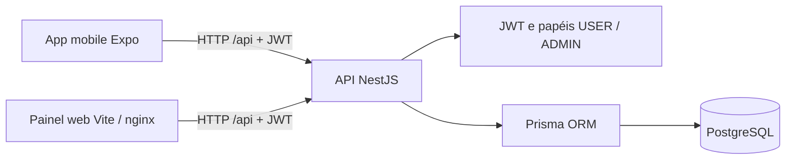

# 🎬 CineApp - Sistema de Venda de Ingressos e Bomboniere

Um sistema Fullstack completo para gerenciamento e venda de ingressos de cinema e lanches (bomboniere). O aplicativo permite que o usuário explore o catálogo de filmes, escolha sessões, adicione itens a um carrinho de compras local e finalize pedidos com segurança e histórico de compras.

---

## 🚀 Funcionalidades Principais

* **Autenticação JWT:** Login seguro com controle de sessão.
* **Catálogo de Filmes e Sessões:** Listagem dinâmica de filmes em cartaz integradas com salas e horários.
* **Bomboniere (Snacks):** Opção de compra de combos de lanches com controle de quantidade.
* **Carrinho Inteligente:** Carrinho de compras gerenciado no lado do cliente (`AsyncStorage`), otimizando chamadas ao backend e permitindo mesclar ingressos e lanches no mesmo pedido.
* **Histórico de Pedidos:** Tela exclusiva de "Meus Pedidos", listando o histórico detalhado de compras atrelado exclusivamente ao usuário logado.

---

## 🛠️ Tecnologias Utilizadas

O projeto foi dividido em três frentes, utilizando as melhores práticas do ecossistema JavaScript/TypeScript:

### 📱 Frontend (Mobile)
* **React Native & Expo:** Framework para desenvolvimento mobile cross-platform.
* **TypeScript:** Tipagem estática para maior segurança do código.
* **Axios:** Consumo eficiente da API REST.
* **AsyncStorage:** Armazenamento local para o Token JWT e persistência do Carrinho de Compras.

### 🖥️ Painel web
* **TypeScript & Vite:** Painel servido por nginx no Docker.
* **Bootstrap:** Componentes e estilos da interface.

### ⚙️ Backend (API)
* **NestJS:** Framework Node.js progressivo para construção de aplicações eficientes e escaláveis.
* **Prisma ORM:** Gerenciamento do banco de dados com tipagem forte e migrações automatizadas.
* **PostgreSQL:** Banco de dados relacional robusto.
* **Swagger:** Documentação automatizada das rotas da API.

---

## Arquitetura



As leituras do catálogo são públicas. O JWT identifica o usuário nas rotas pessoais; o papel `ADMIN` autoriza as escritas no catálogo. As rotas e permissões estão resumidas abaixo em **Permissões e preço do ingresso**.

## Primeiros passos

1. Copie `.env.example` para `.env` na raiz e preencha `JWT_SECRET`, `ADMIN_EMAIL` e `ADMIN_PASSWORD` com valores próprios.
2. Suba banco, API e painel e inicialize os dados:

   ```bash
   docker compose up --build -d
   docker compose exec backend npx prisma migrate deploy
   docker compose exec backend npx prisma db seed
   ```

3. Abra `http://localhost:8080`, entre com as credenciais de admin e selecione **Modo Admin** para gerenciar o catálogo.
4. Em `mobile/`, copie `.env.example` para `.env` e ajuste `EXPO_PUBLIC_API_URL` para a API (no celular físico, use o IP da máquina). Execute `npm install` e `npx expo start`; abra no Expo Go, cadastre um cliente e entre com essa conta `USER`.

O seed inclui três gêneros, três filmes, duas salas com capacidade, três sessões futuras com preço e três combos. Reexecuções preservam os dados existentes, inclusive horários e preços das sessões; sessões vencidas não são reagendadas. Execute uma instância por vez: títulos de filmes e nomes de salas/perfis não possuem restrição única.

## 📦 Como rodar o projeto localmente

### Pré-requisitos
Certifique-se de ter o [Node.js](https://nodejs.org/) e o [PostgreSQL](https://www.postgresql.org/) instalados em sua máquina. O aplicativo mobile requer o aplicativo [Expo Go](https://expo.dev/client) no seu celular ou um emulador configurado.

### 1. Clonando o repositório
```bash
git clone https://github.com/huguerra1/app-cinema.git
cd app-cinema
```

### Opção A — Tudo com Docker (banco + API + web)
```bash
cp .env.example .env   # defina JWT_SECRET
docker compose up --build
```
A API fica em `http://localhost:3000/api` (Swagger no mesmo endereço) e o front web em `http://localhost:8080`.

### Opção B — Rodando cada parte

**Backend**
```bash
cd backend
npm install
cp .env.example .env   # ajuste DATABASE_URL e defina JWT_SECRET
npx prisma migrate dev
npm run start:dev
```

**Mobile**
```bash
cd mobile
npm install
cp .env.example .env
# Ajuste EXPO_PUBLIC_API_URL; no celular físico, use o IP da sua máquina
npx expo start
```
Depois de iniciar o Expo, escaneie o QR Code com o aplicativo Expo Go no celular.

### Primeiro administrador e painel web

No `backend/.env`, configure `DATABASE_URL`, `JWT_SECRET` e, opcionalmente, `ADMIN_EMAIL` e `ADMIN_PASSWORD`. Use um email exclusivo para o administrador e uma senha forte. Em seguida, dentro de `backend/`:

```bash
npx prisma generate
npx prisma migrate deploy
npx prisma db seed
```

O seed reutiliza ou cria os perfis `USER` e `ADMIN`. Com as duas variáveis de admin preenchidas, cria a conta com senha em hash scrypt. Sem ambas, cria os perfis e os dados de exemplo, sem admin, e emite um aviso. Pode ser executado novamente: não troca senhas nem promove contas existentes. Se o email já pertencer a outro perfil, falha e pede um email exclusivo. Execute uma instância do seed por vez, pois o nome do perfil ainda não tem restrição única. O comando está registrado em `package.json` (`prisma.seed`) e em `prisma.config.ts` para o Prisma 7. Depois da criação, remova as credenciais de bootstrap do ambiente.

Com Docker, após iniciar os serviços, aplique a migration e execute o seed manualmente. As variáveis são lidas do `.env` da raiz pelo Compose:

```bash
docker compose exec backend npx prisma migrate deploy
docker compose exec backend npx prisma db seed
```

Para o painel local, dentro de `frontend/`:

```bash
npm install
cp .env.example .env
npm run dev
```

`EXPO_PUBLIC_API_URL` define a URL da API no mobile, com padrão `http://localhost:3000/api`; reinicie o Expo após alterar o ambiente.

`VITE_API_URL` define a URL pública da API e tem padrão `http://localhost:3000/api`; é incorporada no build do Vite. Ao mudar a variável, reinicie o servidor de desenvolvimento ou gere o build novamente. A tela **Entrar / Cadastrar** envia email e senha para `POST /api/users/login`. O painel guarda `access_token` em `localStorage` e envia `Authorization: Bearer` nas chamadas da API, inclusive todas as escritas. O botão **Modo Admin** aparece para contas ADMIN; a autorização é validada pelo servidor. Sair remove o token; respostas 401 também encerram a sessão local.

### Permissões e preço do ingresso

Todas as rotas abaixo usam o prefixo `/api`:

| Recurso / rotas (prefixo `/api`) | Acesso |
| --- | --- |
| GET `/movie`, `/genre`, `/room`, `/session`, `/snack-combo` e `/:id` | Público |
| POST nesses recursos; PATCH/DELETE `/:id` | ADMIN com JWT (sem token: 401; USER: 403) |
| POST `/users`, `/users/login` | Público; cadastro sempre cria USER |
| GET `/users`, `/users/me` | Usuário logado; retorna somente a própria conta |
| GET/PATCH/DELETE `/users/:id` | Dono da conta |
| POST `/order`, GET `/order`, `/order/me` | Usuário logado; cria/lista os próprios pedidos |
| GET `/order/user/:userId`, GET/PATCH/DELETE `/order/:id` | Dono; PATCH de itens ainda bloqueado |
| POST `/ticket` | Usuário logado; pedido informado deve ser próprio |
| GET `/ticket`, GET/PATCH/DELETE `/ticket/:id` | Dono do pedido vinculado; listagem filtrada pelo JWT |
| POST/GET `/address`, GET/PATCH/DELETE `/address/:id` | Usuário logado; somente endereço próprio |
| GET `/profile`, `/profile/:id` | Usuário logado; somente o próprio perfil |
| POST `/profile`, PATCH/DELETE `/profile/:id` | Bloqueado (403), inclusive para ADMIN |

ADMIN não recebe acesso aos dados pessoais de outros usuários.

Não há rotas PUT no catálogo; esse método retorna 404. Tokens antigos sem `role` consultam o perfil no banco pelo `sub` antes de autorizar as escritas. Tokens com papel usam a informação assinada e expiram em um dia; mudanças de papel exigem novo login ou expiração do token anterior.

`Session.price` é obrigatório no banco e tem padrão 25, inclusive nas sessões existentes após a migration. ADMIN pode definir ou editar um preço não negativo em `/session`. `POST /ticket` usa o preço atual da sessão e ignora o campo legado `price` do cliente, que agora é opcional. PATCH de ingresso também ignora `price` e impede trocar a sessão, preservando o preço da compra. O painel exibe o preço da sessão, sem edição no PDV, e cria o ingresso antes do pedido para incluir seu valor no total. O mobile usa o preço da sessão no carrinho; o servidor continua sendo a fonte do preço ao criar o ingresso.

Ainda estão pendentes as transações para reserva/vinculação de ingressos, a propriedade de ingressos sem pedido e o recálculo dos totais ao alterar/excluir ingressos de pedidos existentes. O preço mostrado em carrinhos antigos pode ficar desatualizado se o admin mudar a sessão antes da compra.

## 🏗️ Modelagem do banco de dados (resumo)
A arquitetura do banco foi desenhada para refletir um ambiente real de e-commerce e cinema:

- **Identidade e segurança:** User, Profile e Address
- **Domínio do cinema:** Movie, Genre, Room e Session
- **Vendas:** Ticket, SnackCombo, Order e SnackCombosOnOrders (relacionamento N:M)

Feito com dedicação por Hugo Fonseca Mourão 👨‍💻
